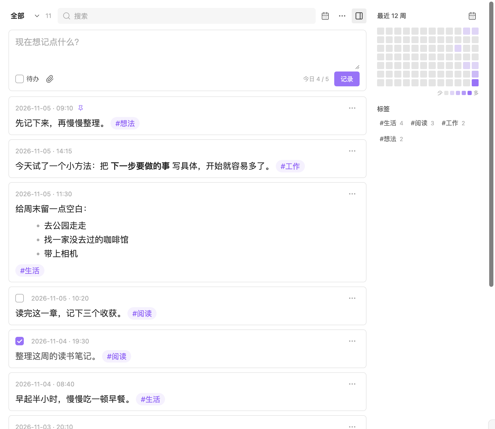

# Simple Memo

[简体中文](README.zh-CN.md)

Local memos for Obsidian, stored in your daily Markdown notes. No account or subscription required.

## Features

- Quick capture, Markdown previews, and saved drafts
- Tags, search, date filters, a calendar, and an activity heatmap
- Tasks, pinned memos, archives, and a recoverable recycle bin
- Image and file attachments, and random review

## Install

Requires Obsidian 1.7.2 or later.

1. Download the ZIP from [Releases](https://github.com/bitxinyu/obsidian-simple-memo/releases/latest).
2. Extract the `simple-memo` folder into your vault's `.obsidian/plugins/` folder.
3. Restart Obsidian and enable **Simple Memo** under **Settings → Community plugins**.

To update, disable the plugin, replace its files, and enable it again.

## Use

Open Simple Memo from the ribbon icon or the command palette. Write a memo and click the save button, or press **Cmd/Ctrl + Enter**. Use `#tags` in the text, select the task checkbox for a to-do, and paste or drop attachments into the main input.

Use the toolbar to search and filter. Each memo's **…** menu includes editing, copying, pinning, archiving, and deletion. Deleted memos can be restored from the recycle bin.

New installations save daily notes in `Journal`. To use existing notes, set the daily-note folder and filename format in **Settings → Simple Memo**. The interface is currently in Simplified Chinese.

## Thino compatibility

Simple Memo reads Thino-style daily memos, including pinned and archived states. On first use, it imports supported Thino settings when they are present. Only daily-note sources are supported. This is an independent implementation, unaffiliated with Thino.

## Data and compatibility

Memo text stays in your daily notes. Drafts and recycle-bin entries are stored in `.obsidian/plugins/simple-memo/data.json`; include that file in backups. Attachments are saved in the vault's `附件` folder.

The plugin does not make its own network requests or provide a sync service. Existing vault sync continues to handle your files. External images in memo content may load through Obsidian's Markdown renderer.

Tested on macOS with Obsidian 1.14.4. Mobile support is enabled, but mobile devices and simultaneous editing across devices have not been tested.

## Development

Run `npm ci`, then `npm run lint`, `npm test`, and `npm run build`. A tag matching the manifest version, or the Release workflow, builds and publishes the installation files.

[MIT license](LICENSE).
