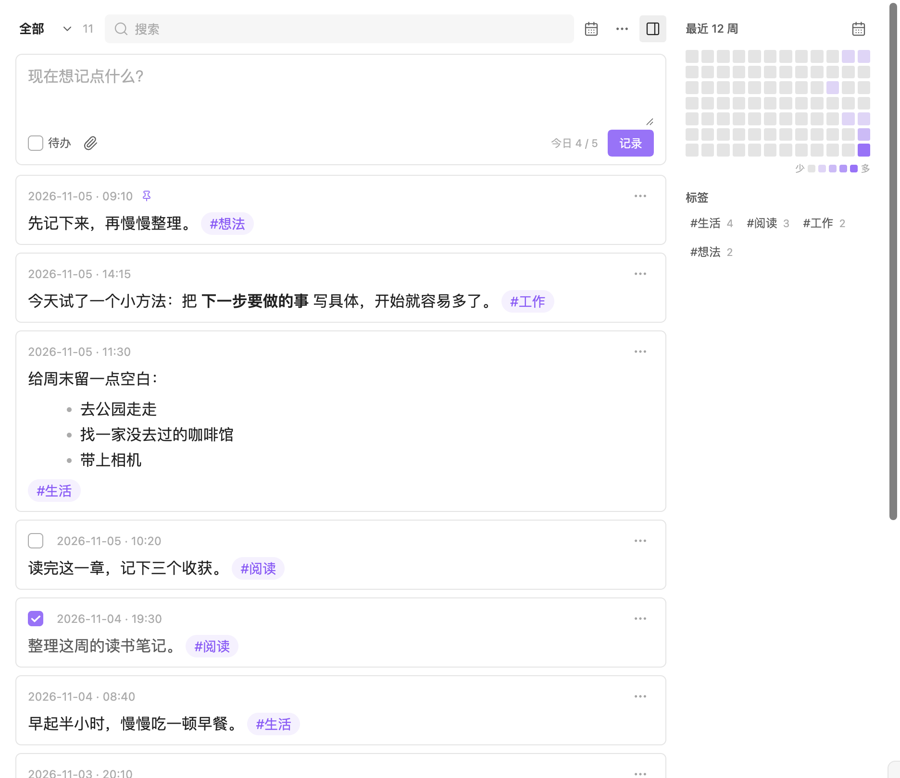

# Simple Memo

[English](README.md)

一个 Obsidian 本地便签插件。便签保存在日记中，无需账号或订阅。

## 功能

- 快速记录、Markdown 预览、草稿自动保存
- 标签、搜索、日期筛选、日历和热力图
- 待办、置顶、归档、回收站
- 图片和文件附件、随机回顾

## 安装

需要 Obsidian 1.7.2 或更新版本。

1. 下载并解压 [安装包](https://github.com/bitxinyu/obsidian-simple-memo/releases/latest)。
2. 将 `simple-memo` 文件夹放入笔记库的 `.obsidian/plugins/` 目录。
3. 重启 Obsidian，在「设置 → 第三方插件」中启用 **Simple Memo**。

更新时关闭插件，覆盖安装包中的文件，再重新启用。

旧版用户请先停用旧插件，再安装新版。首次启用会自动复制旧设置、草稿和回收站，旧文件保留；自定义快捷键需重新绑定。

## 使用

点击左侧便签图标，或在命令面板中选择 **Simple Memo: 打开便签**。输入内容后点击「记录」，也可以按 **⌘ / Ctrl + Enter** 保存。

正文中可以添加 `#标签`，保存前勾选「待办」可创建任务。主输入框支持粘贴、拖入图片和文件，也可以点击附件按钮添加。

顶部工具栏用于搜索和筛选；便签右上角的「…」菜单提供编辑、复制、置顶、归档和删除操作。误删的便签可以在「回收站」恢复。

命令面板还提供「快速记录」和「将选中文本复制为便签」，可在 Obsidian 设置中绑定快捷键。

新安装默认将日记保存在 `Journal` 文件夹。使用已有日记时，请在「设置 → Simple Memo」中调整日记目录和日期格式。

## Thino 兼容

首次启用会自动继承已有 Thino 的兼容设置，直接读取原有每日便签，包括置顶和归档状态，无需转换。目前仅支持每日笔记来源。

可以保留原版 Thino，两者共用日记文件。通过 Simple Memo 删除的便签，需要在 Simple Memo 的回收站中恢复。

## 其他说明

- 便签正文保存在日记中。备份或迁移时，如需保留草稿和回收站，请同时保留 `.obsidian/plugins/simple-memo/data.json`。
- 同步使用笔记库现有的同步方案，插件不提供同步服务。
- 已在 macOS、Obsidian 1.14.4 上验证。保留移动端支持，移动设备及多设备同时编辑尚未实机验证。
- 独立实现，与 Thino 无隶属关系；兼容其每日笔记格式。
- 开源协议：[MIT](LICENSE)。
